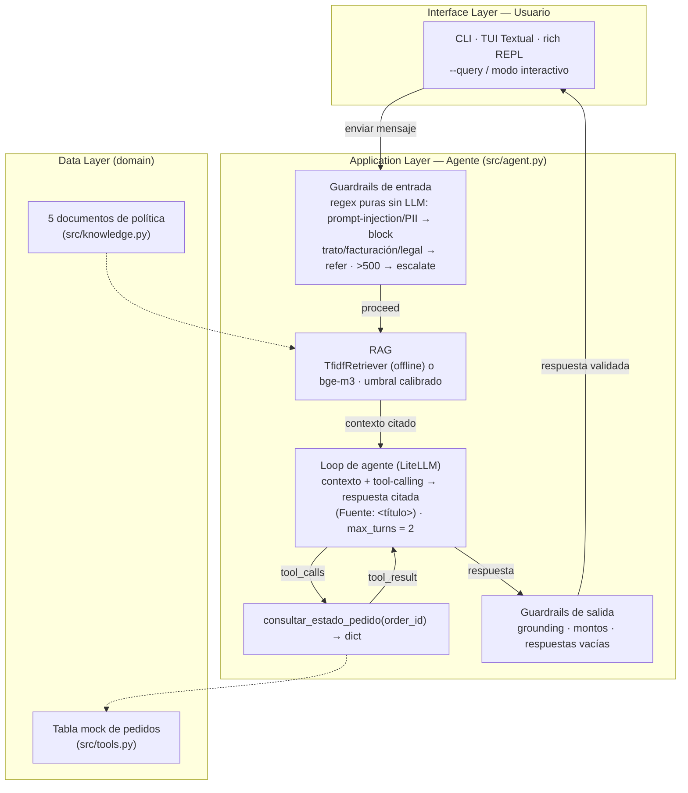

# TiendaHogar — Agente de Soporte al Cliente

[](https://www.python.org/)
[](https://docs.astral.sh/uv/)
[](https://github.com/RLFreddy/ai-retail-support-agent/actions/workflows/ci.yml)
[](https://github.com/RLFreddy)

Agente conversacional de soporte para una tienda de electrodomésticos: responde sobre **garantías, devoluciones, envíos, reembolsos y estado de pedidos** con **RAG + tool-calling + guardrails**. Cita los 5 documentos de política, ejecuta la tool `consultar_estado_pedido` cuando toca y **nunca inventa datos**.

<p align="center">
  
</p>

**Stack:** Python 3.12 · uv · LiteLLM (modelos intercambiables) · scikit-learn (TF-IDF) · pytest · Textual/rich · FastMCP. Sin API key arranca en **modo mock determinista, sin red**: tests y golden set pasan en cualquier máquina.

---

## Prerrequisitos

| Herramienta | Instalación |
|---|---|
| **Python** >= 3.12 | [python.org](https://www.python.org/downloads/) o `apt install python3.12` |
| **uv** (0.11+) | `curl -LsSf https://astral.sh/uv/install.sh \| sh` ([guía](https://docs.astral.sh/uv/getting-started/installation/)) |
| **Docker** | [docker.com](https://www.docker.com/) (+ engine NVIDIA `--gpus` para el modo semántico TEI) |
| **Make** | incluido en Linux/macOS; en Windows `choco install make` |

---

## Quick Start

### Con Docker / Make

```bash
make build     # construye la imagen (docker build -t tiendahogar .)
make run       # demo por defecto (modo mock, sin red)
make repl      # REPL interactiva rich (TTY)
make tui       # TUI interactiva Textual (TTY)
make query Q="¿Dónde está mi pedido ORD-1002?"   # una consulta puntual
make test      # pytest dentro de la imagen
make lint      # ruff check src tests scripts
make evaluate  # golden set en la imagen
make benchmark # 4 variantes + SUMMARY (scripts/benchmarks/)
make mcp-smoke # prueba el servidor MCP (exit 0/1)
```

### Con uv (local, recomendado)

```bash
uv sync --extra dev                                       # instala deps + dev (equiv. make build)
uv run pytest tests/                                      # suite completa (equiv. make test)
uv run pytest -v -s                                       # tests con prints (depuración)
uv run python -m src.cli --query '¿Cuánto dura la garantía de una lavadora?'   # una consulta (equiv. make query)
uv run tiendahogar                                        # TUI Textual (equiv. make tui)
uv run tiendahogar --plain                                # REPL rich (equiv. make repl)
uv run python -m src.evaluate                             # golden set (equiv. make evaluate)
uv run ruff check src tests scripts                       # lint (equiv. make lint)
uv run python scripts/benchmarks/run_all_benchmarks.py    # 4 variantes (equiv. make benchmark)
uv run python scripts/mcp_smoke_test.py                   # smoke MCP (equiv. make mcp-smoke)
```

### Sin uv (fallback con pip)

```bash
python -m venv .venv && source .venv/bin/activate         # crea y activa el entorno (equiv. make build)
pip install -e ".[dev]"                                   # instala deps + dev
pytest tests/                                             # suite completa (equiv. make test)
pytest -v tests/                                          # tests con prints
python -m src.cli --query '¿Dónde está mi pedido ORD-1002?'   # una consulta (equiv. make query)
tiendahogar                                               # TUI Textual (equiv. make tui)
tiendahogar --plain                                       # REPL rich (equiv. make repl)
python -m src.evaluate                                    # golden set (equiv. make evaluate)
ruff check src tests scripts                              # lint (equiv. make lint)
python scripts/benchmarks/run_all_benchmarks.py           # 4 variantes (equiv. make benchmark)
python scripts/mcp_smoke_test.py                          # smoke MCP (equiv. make mcp-smoke)
```

Tabla completa de comandos en [Available Commands](#available-commands).

---

## Available Commands

### A. Con `make` (Docker)

Todos los targets del `Makefile` reusan `--env-file .env` si existe; sin keys corren en modo mock:

| Comando | Descripción |
|---|---|
| `make build` | construye la imagen (`docker build -t tiendahogar .`) |
| `make run` | demo por defecto (modo mock, sin datos) |
| `make repl` | REPL interactiva de rich (TTY) |
| `make tui` | TUI interactiva de Textual (TTY) |
| `make query Q="..."` | responde una consulta — `make query Q="¿Dónde está mi pedido ORD-1002?"` |
| `make evaluate` | golden set (retrieval@1, guardrails, grounding) |
| `make version` | versión y variante del agente |
| `make shell` | shell interactivo dentro del contenedor |
| `make test` | `pytest` dentro de la imagen |
| `make lint` | `ruff check src tests scripts` dentro de la imagen |
| `make benchmark` | 4 variantes + SUMMARY (reportes persistidos en el host) |
| `make mcp-smoke` | prueba el servidor MCP (exit 0/1) |
| `make clean` | elimina la imagen (`docker rmi tiendahogar`) |

### B. Con `uv` (local)

| Comando | Descripción |
|---|---|
| `uv sync` | instala deps desde `uv.lock` |
| `uv sync --extra dev` | + dev deps (pytest, ruff) |
| `uv run pytest tests/` | suite completa (100% mock, sin red) |
| `uv run pytest -v -s` | tests con prints (depuración) |
| `uv run python -m src.cli --query '...'` | responde una consulta |
| `uv run python -m src.cli --version` | versión y variante activa |
| `uv run tiendahogar` | demo interactiva (TUI Textual) |
| `uv run tiendahogar --plain` | REPL de rich |
| `uv run python -m src.evaluate` | golden set |
| `uv run python -m src.mcp_server` | servidor MCP (FastMCP, stdio) |
| `uv run python scripts/mcp_smoke_test.py` | smoke del MCP (exit 0/1) |
| `uv run python scripts/benchmarks/run_all_benchmarks.py` | 4 variantes + SUMMARY |
| `uv run python scripts/benchmarks/bm_mock_baseline.py` | variante individual: `bm_groq_tfidf.py` · `bm_groq_tei_rerank.py` · `bm_groq_tei_no_rerank.py` |
| `uv run ruff check src tests scripts` | lint (0 errores) |
| `uv run ruff check --fix src tests scripts` | lint con auto-fix |

> Usa **comillas simples** en `--query` cuando el texto lleve `$`:
> `uv run python -m src.cli --query 'Necesito un reembolso de $1200'` — con comillas dobles, bash expandiría `$1200`.

### C. Sin `uv` (pip)

| Comando | Descripción |
|---|---|
| `python -m venv .venv` | crea un entorno virtual |
| `source .venv/bin/activate` (Windows: `.venv\Scripts\activate`) | lo activa |
| `pip install -e ".[dev]"` | instala deps + dev |
| `pytest tests/` | suite completa |
| `pytest -v tests/` | con prints |
| `python -m src.cli --query '?'` | responde una consulta |
| `python -m src.cli --version` | versión |
| `tiendahogar` / `tiendahogar --plain` | TUI / REPL |
| `python -m src.evaluate` | golden set |
| `python -m src.mcp_server` | servidor MCP |
| `python scripts/mcp_smoke_test.py` | smoke MCP |
| `python scripts/benchmarks/run_all_benchmarks.py` | 4 variantes |
| `ruff check src tests scripts` / `ruff check --fix src tests scripts` | lint |

---

## Development

### Modo semántico (TEI, bonus)

RAG con **embeddings bge-m3** y **rerank opcional** en local. Ambos servicios corren como contenedores TEI con GPU (los comandos exactos que usa `scripts/benchmarks/`):

> **Modelos en `data/`:** TEI sirve los pesos desde el volumen que montas (`-v $PWD/data:/data`); por defecto `--model-id` apunta al Hub de HuggingFace y TEI descarga los pesos ahí la primera vez (bge-m3 ≈ 2.3 GB, reranker ≈ 2.6 GB). Para usar una copia local pre-descargada (sin re-descargas ni acceso al Hub), pon los pesos en `./data` y apunta `--model-id` a esa ruta local.

```bash
# 1) Embeddings (bge-m3) — puerto 8080
docker run --rm --gpus all -p 8080:80 -v $PWD/data:/data --pull always \
  --name tei-embed-gpu \
  ghcr.io/huggingface/text-embeddings-inference:cuda-1.9 \
  --model-id BAAI/bge-m3 \
  --served-model-name BAAI/bge-m3 \
  --dtype float32 \
  --max-batch-tokens 2048 \
  --max-client-batch-size 32 \
  --max-batch-requests 32 \
  --auto-truncate

# 2) Reranker (bge-reranker-v2-m3) — puerto 8001
docker run --rm --gpus all -p 8001:80 -v $PWD/data:/data --pull always \
  --name tei-rerank-gpu \
  ghcr.io/huggingface/text-embeddings-inference:turing-1.9 \
  --model-id BAAI/bge-reranker-v2-m3 \
  --max-batch-tokens 4096 --max-client-batch-size 16
```

Para usarlo con un LLM real (Groq + TEI + rerank):

```bash
GROQ_API_KEY=tu_key EMBEDDING_BACKEND=tei TEI_BASE_URL=http://localhost:8080/v1 \
  TEI_RERANK_BASE_URL=http://localhost:8001 RERANK_ENABLED=true \
  uv run python -m src.cli
```

---

## Environment Variables

Copia `/.env.example` a `/.env` y ajusta. Con todas las API keys vacías el agente corre en modo mock.

| Variable | Default | Descripción |
|---|---|---|
| `LLM_MODEL` | `groq/openai/gpt-oss-20b` | Modelo de lenguaje formato LiteLLM (`openai/…`, `azure/…`, `ollama/…`) |
| `GROQ_API_KEY` / `OPENROUTER_API_KEY` / `OPENAI_API_KEY` / `ANTHROPIC_API_KEY` / `GEMINI_API_KEY` | _(vacío)_ | Keys del proveedor (vacías = modo mock) |
| `EMBEDDING_BACKEND` | `offline` | `offline` (TF-IDF) · `tei` · `openrouter` · `openai` · `gemini` |
| `TEI_BASE_URL` · `TEI_EMBED_MODEL` | `http://localhost:8080/v1` · `openai/BAAI/bge-m3` | Servidor TEI local (embeddings) |
| `TEI_RERANK_BASE_URL` · `TEI_RERANK_MODEL` | `http://localhost:8001` · `BAAI/bge-reranker-v2-m3` | Servidor TEI local (rerank) |
| `RERANK_ENABLED` | `false` | `true` = rerank (cross-encoder TEI local o `litellm.rerank` en nube) |
| `RERANK_MODEL` | `cohere/rerank-v3.5` | modelo de rerank para nube |
| `TOP_K` | `3` | documentos recuperados |
| `RELEVANCE_THRESHOLD` | `0.15` | umbral TF-IDF (ver `SUBMISSION.md`) |
| `SEMANTIC_THRESHOLD` | `0.56` | umbral embeddings bge-m3 (ver `SUBMISSION.md`) |
| `MAX_TURNS` | `2` | iteraciones máximas del loop de tool-calling |
| `SYSTEM_PROMPT` | `auto` | `auto` (por defecto) o ruta a un `.txt` |
| `TUI` | `textual` | `textual` · `rich` |

> `.env` está en `.gitignore`; `uv.lock` se commitea (equivale a `package-lock.json`).

---

## Arquitectura



**Flujo resumido:**

1. **Guardrail de entrada** — reglas puras y deterministas (sin LLM): bloquea inyección de prompt y PII; **deriva al humano** quejas de trato, disputas de facturación y temas legales; **escala a supervisor** reembolsos > $500.
2. **RAG** — recupera el documento relevante de los 5 de política (TF-IDF offline o bge-m3 opcional). Si nada supera el umbral, no hay contexto: el agente **no inventa**.
3. **Loop de agente** — LiteLLM con la tool `consultar_estado_pedido`; ejecuta la llamada y realimenta al modelo hasta `MAX_TURNS=2`. Respuesta final con cita: `(Fuente: <título>)`.
4. **Guardrail de salida** — verifica grounding (números/plazos vs corpus), bloquea auto-aprobación de reembolsos y respuestas vacías.

Justificación completa, decisiones de RAG y mapeo a producción (Microsoft Foundry · Databricks · Apigee · Kafka): **[SUBMISSION.md](SUBMISSION.md)**.

---

## Evaluación

```bash
uv run pytest tests/
```

**Toda la suite pasa** — 100% mock determinista, sin red. Cubre los 3 casos críticos y más:

- **RAG** — recupera el documento correcto para una pregunta de garantía; una irrelevante no devuelve contexto.
- **Tool** — `consultar_estado_pedido` responde un ID válido y marca `encontrado: False` para uno inexistente (sin inventar).
- **Guardrail** — reembolso > $500 escala; quejas de trato / disputas de facturación / temas legales se derivan al humano; frontera exacta de $500 no escala.
- Plus — firma exacta de la tool (con `inspect`), integración del loop, servidor MCP, retriever semántico (stubs).

**Benchmarks** (8 queries curadas, reportes en `scripts/benchmarks/reports/`):

| Variante | LLM | Retrieval | Resultado |
|---|---|---|---|
| `mock_baseline` | mock | TF-IDF | 7/8 (87.5%) |
| `groq_tfidf` | Groq | TF-IDF | 7/8 (87.5%) |
| `groq_tei_rerank` | Groq | bge-m3 + cross-encoder | **8/8 (100%)**\* |
| `groq_tei_no_rerank` | Groq | bge-m3 (coseno puro) | **8/8 (100%)**\* |

\* Con los 2 contenedores TEI levantados. Con TEI apagado esos 2 reportan `SKIP` (infra no disponible), no `FAIL`.

**Fallo conocido:** `q05 "¿Me llegan compras al interior del país?"` falla con TF-IDF (no dice "envío") y pasa con bge-m3; es la referencia del baseline, no un error del script.

```bash
uv run ruff check src tests scripts   # All checks passed
```

El CI (`.github/workflows/ci.yml`) ejecuta exactamente estos comandos en cada push.

---

## Tech Stack

- **Python 3.12** + **uv** (entorno reproducible, `uv.lock`)
- **LiteLLM** — capa de modelos (Groq/OpenAI/Azure/Anthropic/Ollama) con `MockLLM` sin red
- **scikit-learn** — retriever TF-IDF offline
- **bge-m3** (TEI / OpenRouter / OpenAI / Gemini) — embeddings opcionales + rerank
- **pydantic-settings** — configuración `.env` tipada
- **pytest + ruff** — calidad
- **Textual / rich** — TUI y REPL
- **FastMCP** — la tool expuesta como servidor MCP (stdio)

---

## Project Structure

```
src/
  cli.py          → punto de entrada (--query / --plain / --version)
  cli_textual.py  → TUI Textual
  cli_rich.py     → REPL rich
  agent.py        → loop de agente (guardrails + RAG + tools)
  llm.py          → LiteLLMClient + MockLLM + build_client
  guardrails.py   → reglas puras de entrada/salida
  retrieval.py    → TfidfRetriever + SemanticRetriever + rerank opcional
  knowledge.py    → 5 documentos de política + system prompt
  tools.py        → consultar_estado_pedido (tabla mock)
  mcp_server.py   → tool expuesta como servidor MCP (FastMCP)
  config.py       → Settings con pydantic-settings
  evaluate.py    → golden set (bonus)
tests/            → 8 archivos (100% mock, sin red)
scripts/
  benchmarks/     → harness + 4 variantes + runner + reports
  mcp_smoke_test.py → smoke del MCP (exit 0/1)
Makefile          → docker build / run / test / lint / benchmark ...
SUBMISSION.md     → arquitectura, decisiones técnicas y mapeo a producción
```

---

Built by [RLFreddy](https://github.com/RLFreddy)
